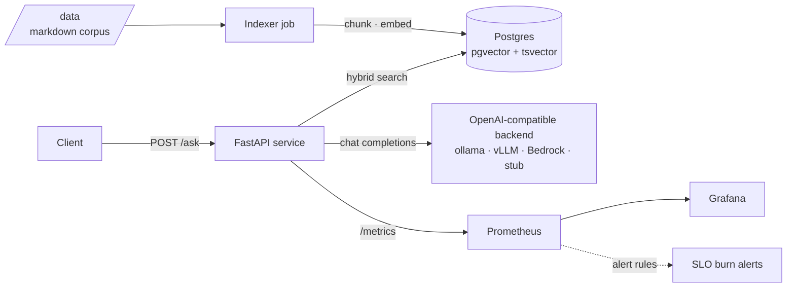

# Jenie Helpdesk AI

A RAG service over an operations knowledge base, deployed as a platform: infrastructure as
code, a gated CI/CD pipeline, SLO-backed observability, and a security baseline.

The AI part is deliberately small. The question this answers is not *can you build RAG* —
it is *can you run an AI workload reliably, observably and cheaply*.

---

## Architecture



Two services and one job. The indexer runs to completion and exits; the API is the only
long-lived process.

---

## Quick start

```bash
cp .env.example .env          # defaults work offline — LLM_BASE_URL unset uses the stub
make up                       # postgres, floci, api, worker, prometheus, grafana
make index                    # index ./data into pgvector
curl -s localhost:8080/healthz
curl -s -X POST localhost:8080/ask \
  -H 'Content-Type: application/json' \
  -d '{"query":"..."}' | jq
make eval                     # run the evaluation set
```

| Service | URL |
|---|---|
| API | http://localhost:8080 |
| Prometheus | http://localhost:9090 |
| Grafana | http://localhost:3000 (admin / `GRAFANA_PASSWORD`) |

**Hosted demo:** TODO — URL, and a note that compose is the guaranteed path.

---

## Repository map

| Path | What |
|---|---|
| `api/` | FastAPI service — `/ask`, `/healthz`, `/readyz`, `/metrics` |
| `worker/` | Indexer job |
| `jenie/` | Shared library: config, retrieval, model backends, telemetry |
| `infra/terraform/` | AWS modules, `dev` and `prod` environments |
| `observability/` | Prometheus scrape config and alert rules, provisioned Grafana |
| `scripts/` | Evaluation harness, load generator |
| `data/` | The corpus |

---

## Configuration

Every knob is an environment variable; see `.env.example`. The one worth calling out:

**`LLM_BASE_URL` selects the model backend and nothing else does.** ollama, vLLM,
Bedrock through Floci and the offline stub are the same code path with a different URL.
Leaving it unset selects the stub, which is what CI uses — tests must not require a GPU.

---

## Observability

Stated objectives, which the alert rules in `observability/prometheus/rules/` defend:

| SLO | Target |
|---|---|
| Availability | 99% of `/ask` requests succeed, 30-day window |
| Latency | 95% of `/ask` requests complete within 3s |
| Retrieval | 95% of vector searches complete within 250ms |

Retrieval and generation are **separate** histograms. Blended into one request duration you
cannot tell a slow vector search from a slow model, which is the first question anyone asks
when `/ask` gets slow.

Cost is tracked as `rag_cost_usd_total`, priced from configured per-1k-token rates rather
than hardcoded constants, because pricing is per model and changes.

TODO: paste the Grafana screenshot and the output of `make eval`.

---

## Security

See [SECURITY.md](SECURITY.md). Summary: no secrets in the repository, dependency and image
scanning gate the pipeline, the container runs as a non-root user from a minimal base, and
**the infrastructure pipeline holds no cloud credentials at all** — see below.

---

## Trade-offs

> TODO — this section is the point. Each entry: what you chose, what you gave up, and when
> you would choose differently. Keep them honest; a reviewer trusts a stated limitation more
> than an unstated one.

**Postgres with pgvector, rather than a dedicated vector database.** TODO — one store to
operate, back up and reason about; hybrid search without a second system; and at this corpus
size the index fits comfortably in memory. Name the point at which this stops being true.

**Hybrid retrieval rather than pure semantic search.** TODO — operations questions are full
of exact tokens (error codes, flag names, hostnames) that embeddings blur. Reciprocal rank
fusion merges both rankings without needing the scores to be comparable.

**LlamaIndex rather than a hand-written retrieval pipeline.** TODO — the platform engineer's
job here is to make the workload deployable and observable, not to reimplement chunking.
Mention that you have written a hybrid-retrieval indexer from scratch on a separate project,
so this is a scope decision rather than an ability one.

**Schema created idempotently on start rather than via a migration runner.** TODO — one
fewer moving part in the critical path at this size; name the point where versioned
migrations become correct.

**Infrastructure validated against a local AWS emulator rather than a live account.** The
Terraform in `infra/` is applied and destroyed against [Floci](https://github.com/floci-io/floci)
on every pull request, so the modules are proven to apply — but the pipeline holds no AWS
credentials and the assignment costs nothing to run. This validates the resource graph and
the API calls; it does **not** validate real IAM evaluation, VPC routing or load balancer
behaviour, and that distinction is deliberate rather than overlooked.

---

## What I would do next

> TODO — scope control reads as judgment; silent gaps read as not knowing. Candidates:
> incremental reindexing with content hashing, OpenTelemetry tracing end to end, a canary
> deployment with automated rollback on the error-rate SLO, reranking after retrieval,
> prompt and model-config versioning, autoscaling the API on p95 rather than CPU.

---

## Assignment notes

Submitted for the Jenosize AI DevOps Engineer test assignment.
