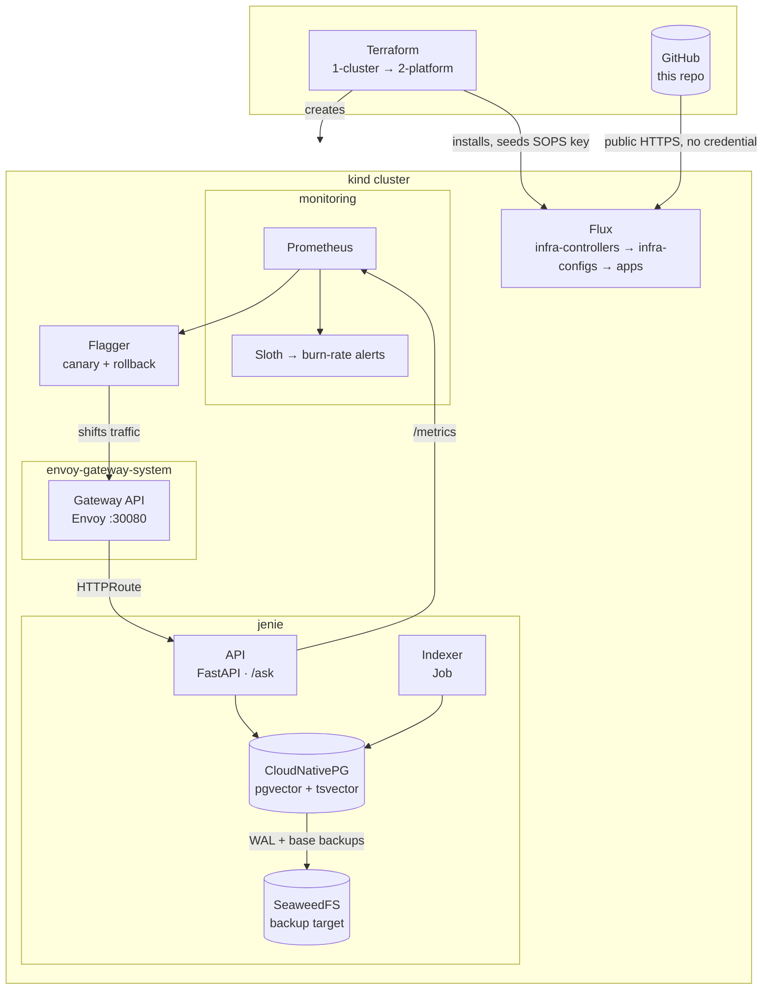

# Jenie Helpdesk AI

A RAG service over an operations knowledge base, delivered as a platform:
infrastructure as code, GitOps reconciliation, progressive delivery,
SLO-backed observability, a security baseline, and backups with a documented
restore.

The AI is deliberately small. The question this answers is not *can you build
RAG* — it is *can you run an AI workload reliably, observably and cheaply*.

---

## Architecture



**Terraform owns only what Flux cannot source from git**: the cluster, the
SOPS age key, and the deploy key image automation commits with. Everything
else is reconciled from this repository. After bootstrap, `kubectl apply` is
a debugging tool, not a deployment tool.

---

## Run it

```sh
make doctor          # check the toolchain before anything else wastes your time
```

Needs `docker`, `kind`, `terraform`, `helm`, `kustomize`, `kubectl`, `age`
and `sops`, plus about 4GB free for one cluster. `make doctor` reports
exactly what is missing and exits non-zero.

> **There is no `docker compose up` path, deliberately.** The brief offers
> compose as an alternative to a deployed URL, and it would be the faster
> thing to hand a reviewer. It is not here because it would be a *second
> definition of the system* — one that drifts from this one and exercises
> none of what makes it interesting: Gateway API routing, Flagger analysis,
> generated SLO alerts, CloudNativePG failover and backups. A compose file
> that demonstrates none of those, while claiming to be the same service,
> is worse than the three minutes `make up-dev` costs.
> See [`docs/decisions.md`](docs/decisions.md).

```sh
make bootstrap       # once: generate the SOPS age key, pin GitHub's host key
make images          # build the API, indexer and pgvector images
make up-dev          # create the cluster, install Flux, reconcile from git
```

Roughly three minutes. Flux then pulls this repository and builds the rest.

```sh
make status          # what Flux thinks of the world
make smoke           # is the gateway answering
curl localhost:8080/readyz
```

### Ask it something

```sh
curl -s localhost:8080/ask -H 'content-type: application/json' \
  -d '{"query":"Why is externalTrafficPolicy set to Cluster?"}' | jq
```

```json
{
  "answer": "Under `Local`, a node only answers a NodePort if it hosts an endpoint...",
  "sources": [
    {"title": "Gateway and routing › externalTrafficPolicy",
     "path": "gateway-and-routing.md", "score": 1.0}
  ],
  "latency_ms": 287
}
```

### Evaluate retrieval

```sh
make eval            # or: python scripts/eval.py --url http://localhost:8080
```

```
PASS  external-traffic-policy    rank 1
PASS  pgvector-extension         rank 1
PASS  canary-gates               rank 1
PASS  slo-buckets                rank 1
PASS  backup-gap                 rank 1
PASS  secrets-ownership          rank 1
PASS  refusal-out-of-corpus      declined

7/7 passed (100%), precision@1 6/6 (100%), p95 330ms
```

The last case asserts the service **declines** an out-of-corpus question and
cites nothing. A service that cannot say "I don't know" is worse than one
that is sometimes wrong.

### Dashboards

Grafana and Prometheus are not routed through the gateway — exposing an
admin console on port 80 is not a thing to ship.

```sh
eval "$(make kubeconfig ENV=dev)"
make grafana      # port-forwards and prints the generated password
```

The dashboard is **Jenie Helpdesk AI** (`/d/jenie-rag`): service health,
error budget, retrieval-versus-generation latency, answer outcomes,
best-match similarity, token cost and index freshness. It ships as a
labelled ConfigMap beside the application manifests, so the service owns its
own dashboard rather than the monitoring namespace owning it.

```sh
kubectl -n monitoring port-forward svc/kube-prometheus-stack-prometheus 9090:9090
# http://localhost:9090/alerts  — the Sloth-generated burn-rate rules
```

### Production

```sh
make up-prod         # second cluster, ports 80/443
make status ENV=prod
make canary ENV=prod # watch a progressive rollout
```

---

## Environment variables

Everything is env-driven; nothing is hardcoded. In the cluster these come
from `kubernetes/apps/jenie/base/config.yaml` and CloudNativePG's generated
secret.

| variable | default | notes |
|---|---|---|
| `PGHOST` `PGPORT` `PGUSER` `PGPASSWORD` `PGDATABASE` | — | CNPG publishes these as `jenie-pg-app` |
| `DATABASE_URL` | unset | overrides the above |
| `EMBEDDING_MODEL` | `BAAI/bge-small-en-v1.5` | 384-dim ONNX, baked into the image |
| `EMBEDDING_DIM` | `384` | part of the table schema — changing it means reindexing |
| `LLM_BASE_URL` | unset | **unset selects the deterministic stub.** Point at vLLM or Ollama to use a real model; no code changes |
| `LLM_MODEL` | `stub` | |
| `LLM_COST_PER_MTOK_IN` / `_OUT` | `0` | feeds `rag_cost_usd_total` |
| `CHUNK_SIZE` / `CHUNK_OVERLAP` | `512` / `64` | |
| `RETRIEVAL_TOP_K` | `5` | |
| `RETRIEVAL_MIN_SIMILARITY` | `0.55` | below this the service declines |
| `DATA_DIR` | `data` | the corpus |

---

## Layout

```
infrastructure/     Terraform — cluster, Flux, bootstrap secrets
  terraform/        modules and per-environment stacks
  images/           the pgvector operand image
kubernetes/
  clusters/         Flux entrypoints, one directory per cluster
  infrastructure/   controllers and their configuration
  apps/jenie/       the service, base + dev/prod overlays
  charts/           service-policy (routing, delivery, policy) and vendored sloth
jenie/              shared library — chunking, embeddings, store, RAG
api/ worker/        the two images
data/               the knowledge base, 13 documents
scripts/            evaluation and load generation
docs/               runbooks and decisions
```

---

## Trade-offs

Read [`docs/decisions.md`](docs/decisions.md). It covers what was built, what
was deliberately not built, and the places this is more platform than the
brief asked for — including what would be cut for a smaller team.

Operational procedures are in [`docs/runbooks/`](docs/runbooks/), including a
[disaster recovery runbook](docs/runbooks/dr-restore.md) that states what the
backup strategy does *not* protect against.

Security posture and threat assumptions are in [`SECURITY.md`](SECURITY.md).
